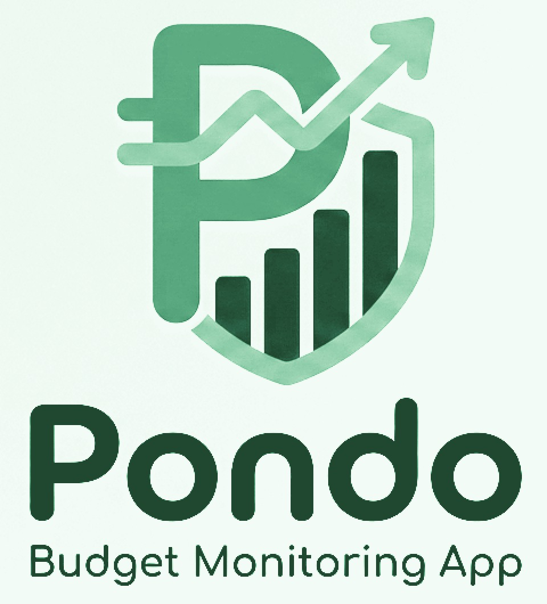

# Pondo



A calm, pastel-green **Budget ni Pot** for **GCash** and **cash**. Log what you
spend and receive, set monthly limits per category, and see exactly how much is
left — all stored locally in your browser.

   

**No framework.** Pondo is built with plain HTML, CSS, and TypeScript. The UI is
rendered with template strings, a tiny observable store, and event delegation —
no React, Vue, or other runtime library.

## Features

- **Two wallets, one picture** — separate GCash and cash balances that roll up
  into a total, starting from amounts you set yourself.
- **Fast logging** — expense/income toggle, quick-amount chips, category chips,
  date and note, all in a single modal.
- **Starter categories** — Rent, Groceries, Electric Bill, Water Bill, Market,
  and Internet are ready on first launch, with room to add your own.
- **Monthly budgets** — set a limit per category, watch progress bars fill, and
  get flagged when a category goes over.
- **Reports** — six-month income-vs-spending chart, category breakdown, and a
  donut showing where your money sits.
- **Month switching** — flip back and forth between months on every page.
- **Private by default** — data lives in `localStorage`; export a JSON backup
  anytime from Settings, and restore it on another device.
- **Responsive** — sidebar on desktop, bottom navigation and floating add button
  on mobile.

## Getting started

```bash
npm install
npm run dev
```

Open the URL Vite prints (default `http://localhost:5173`). The app starts with
zero balances and six starter categories — **Rent, Groceries, Electric Bill,
Water Bill, Market, and Internet**. Add your own starting balances in
**Settings**, set monthly limits for the categories in **Budgets**, then log
your first entry. A demo month is available anytime under **Settings → Load
sample month**.

### Scripts

| Command           | What it does                              |
| ----------------- | ----------------------------------------- |
| `npm run dev`     | Start the Vite dev server with hot reload |
| `npm run build`   | Type-check and build for production       |
| `npm run preview` | Preview the production build locally      |

## Deploying to GitHub Pages

The workflow in `.github/workflows/deploy.yml` builds and deploys the site
whenever you push to `main` (or run it manually from the Actions tab). In your
repository, open **Settings → Pages** and set the build and deployment source
to **GitHub Actions**. After the workflow succeeds, GitHub will show the site
URL on the Pages settings page. The build automatically uses the repository
path so assets load correctly on a project site.

## Tech

- **HTML + CSS + TypeScript** — no UI framework and no runtime dependencies
- **TypeScript** in strict mode
- **Vite** for the dev server and production build (build tooling only)
- **Tiny observable stores** — `budgetStore` and `uiStore` expose
  `subscribe`/`getSnapshot`, and the app re-renders on change
- **Template-string views** — each page is a pure function that returns HTML;
  `App.ts` swaps it into `#root`
- **Event delegation** — one set of document-level listeners handles clicks,
  input, submit, and keyboard shortcuts through `data-action` attributes
- **No router dependency** — views are switched through the UI store

The production build is plain HTML, CSS, and JavaScript in `dist/`, so it can be
hosted on any static host.

## Brand

`resources/logo-original.jpg` is the source artwork. It is inverted into the
app's light palette — a near-white mint tile with the peso emblem in green — so
the brand reads as part of the pastel UI instead of a heavy dark block. The
in-app mark (`public/logo-mark-light.jpg`), favicon (`public/icon-512.png`), and
touch icon (`public/apple-touch-icon.png`) all come from the same emblem crop,
while `resources/icon.png`, `resources/splash.png`, and `resources/logo.jpg` are
the store/Android versions of the same grade.

## Project structure

```
index.html                HTML shell and font/theme metadata
src/
  main.ts                 Entry point: styles + app bootstrap
  app/App.ts              Renders views, handles events and the transaction modal
  components/
    layout.ts             App shell: sidebar, mobile nav, floating add button
    transactions.ts       Transaction list, row, form, and modal markup
    budgets.ts            Budget cards and the new-category form
    reports.ts            Month chart, category split, balance donut
    common/               Icons, logos, progress bar, header, toast, empty state
    layout/nav.ts         Navigation items shared by sidebar and mobile nav
  features/
    dashboard.ts          Dashboard page
    transactions.ts       Transactions page with filters
    budgets.ts            Budget planning page
    reports.ts            Analytics page
    settings.ts           Starting balances and data management
    auth/                 (reserved)
    accounts/             (reserved)
    categories/           (reserved)
  stores/
    budgetStore.ts        App data: accounts, categories, transactions
    uiStore.ts            View, month, filters, modal, toast, form drafts
  lib/
    calc.ts               Balance, totals, budget, and report calculations
    storage.ts            localStorage persistence, validation, backup import
    seed.ts               Empty state and sample month
    categoryIcons.ts      Emoji suggestions for categories
    labels.ts             Human-readable account/kind labels
  types/index.ts          Shared TypeScript models
  utils/                  Formatting, dates, ids, HTML escaping
  styles/globals.css      Global stylesheet and pastel-green theme tokens
  services/               (reserved for a backend client)
  hooks/                  (reserved for reusable hooks)
public/                   Static assets (app mark, favicon, GCash logo)
resources/                Brand source: logo, Android icon and splash
docs/                     Documentation and design notes
tests/                    unit / integration / e2e (reserved)
scripts/                  Automation scripts (reserved)
config/                   Environment and app configuration (reserved)
.github/workflows/        CI/CD (deployment)
```

## How balances are calculated

```
GCash balance = starting GCash + income to GCash − expenses from GCash
Cash balance  = starting cash  + income to cash  − expenses from cash
```

Budget progress compares the month's expenses in each category against its
monthly limit. Values are stored in pesos; amounts are kept to two decimals.

## Data & privacy

Everything is kept in your browser under the `pondo.state.v2` key. Nothing is
uploaded. Use **Settings → Export backup** to download a JSON snapshot before
clearing site data, and **Import backup** to restore it later or move it to
another device.

## Roadmap ideas

- Recurring bills and subscriptions
- Savings goals with target dates
- Optional cloud sync / authentication (see `src/features/auth`)
